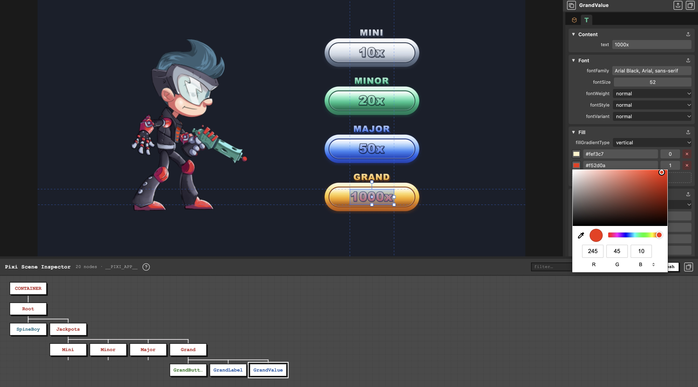

# Pixi Scene Inspector



[Live demo](https://eneaentertainment.github.io/pixi-scene-inspector/) · [PixiJS 3D demo](https://eneaentertainment.github.io/pixi-scene-inspector/3d/)

[](https://chromewebstore.google.com/detail/pixi-scene-inspector/ofhbddhfahkompjbgnodecgiikbnhdgi)

Chrome extension (and optional in-page overlay) that detects a PixiJS app and visualizes its **scene tree**. Nodes are colored by display-object type; custom labels and invisible nodes are shown distinctly. The docked overlay also opens a **properties** inspector for the selected node. Also works with **[@pixi/3d](https://github.com/pixijs/3d)** scenes (typed 3D nodes, extra properties, raycast pick, transform gizmo).

## Setup

```bash
npm install
npm run build
```

Load the extension:

1. Open `chrome://extensions`
2. Enable **Developer mode**
3. **Load unpacked** → select the `build/` folder

## Usage (Chrome extension)

In your game/app, expose the Pixi application (first match wins):

```js
globalThis.__PIXI_APP__ = app;
```

Lookup order: `__PIXI_STAGE__` → `__PIXI_APP__.stage` → `renderer.lastObjectRendered` / `_lastObjectRendered` (from `__PIXI_RENDERER__` or `__PIXI_APP__.renderer`).

To enable the **texture browse picker** in Properties, also expose the texture / Assets cache:

PixiJS v8:

```js
import { Cache } from 'pixi.js';

globalThis.__PIXI_APP__ = app;
globalThis.__PIXI_CACHE__ = Cache;
```

PixiJS v7:

```js
import { utils } from 'pixi.js';

globalThis.__PIXI_APP__ = app;
globalThis.__PIXI_CACHE__ = utils.TextureCache;
```

Without `__PIXI_CACHE__`, the texture property field still accepts a typed name (silent revert if unresolved). The browse (`…`) picker stays hidden.

With the extension loaded, press **Shift+`` ` ``** on the game page to toggle the **docked** in-page panel (same behavior as `togglePixiSceneInspector` — no game import needed). Press again to close. The chord is configurable in the extension popup (default **Shift+`` ` ``**; at least one modifier is required).

The header shows node count and which global was used. **live** refresh (~1s) is on by default; uncheck it or click **Refresh**. Use the **filter…** field to keep only matching nodes (and their ancestors); matches are highlighted. Press **?** for the shortcuts panel (Esc closes it).

Selected node is available in the page console as `$pixi`.

### Extension options (toolbar popup)

Open the extension action popup to change:

| Setting | Notes |
| --- | --- |
| **Toggle shortcut** | Record a new chord (modifier required). **Reset** restores **Shift+`` ` ``**. |
| **Live refresh** | Interval 0–10 s in 0.5 s steps (**0** turns live refresh off). |
| **Selection highlight** | Fill / stroke colors and fill alphas (idle + while dragging). |
| **Highlight guides** | Guide lines from the selection box edges (idle and/or while dragging). |
| **Canvas pick** | **Canvas pick can select invisible nodes** (off by default). |

Colors, guides, interval, hotkey, and pick preference sync via `chrome.storage.sync`. Panel layout and the in-panel **highlight** checkbox stay in page `localStorage`.

### Selection highlight (docked overlay)

Enable **highlight** in the header (off by default) to outline the selected **2D** node on the game canvas. Anchor, when present, is marked with a small circle. The setting is remembered in `localStorage`.

For a single selected **@pixi/3d** node the 2D outline is replaced by a **3D transform gizmo** (local axes). Modes: **W** move, **E** rotate, **R** scale (or the mode buttons in the top-right corner of the game shell). Hold **Option/Alt** while dragging to snap (position / angle / scale steps). Multi-select hides the gizmo and draws the union of selected **2D** bounds only.

### Properties panel (docked overlay)

Docked mode mounts a right-side **Properties** panel for the selected node (transform, visibility, rendering, interactivity, plus @pixi/3d / Spine sections when relevant). Fields appear only when the live Pixi object exposes them (and pass per-type policy — e.g. cameras omit size / scale / interactivity; ambient lights omit position / rotation).

- Toggle **Float** / **Dock** in the panel header: floating mode can be dragged and corner-resized; docked mode resizes from the left edge and shrinks the game shell.
- Number fields support click-drag scrubbing (Esc cancels an in-progress scrub). Hold **Option/Alt** when releasing a scrub, or when nudging with the field arrows / `↑` `↓`, to snap the value to the nearest step.
- Layout for both panels (`properties` / `tree`: mode, position, width, height) and the **highlight** toggle are stored in `localStorage` under `pixi-scene-inspector-settings`.

Plain `mountPixiSceneInspector` (no docked overlay) does not include the properties panel.

### Selection & expand

| Action | Effect |
| --- | --- |
| Click | Select (first click on a new node does not expand) |
| Shift or ⌘/Ctrl+click | Toggle multi-select (see below) |
| Second click / `+` / `=` | Expand one level |
| Option/Alt+click / `-` / `_` | Collapse one level |
| ⌘+⌥+click (macOS) / Ctrl+Alt+click (Windows) on the **game canvas** | Select the topmost node under the cursor without firing game input; click again without moving to cycle overlapping nodes |

Canvas pick ignores `visible === false` nodes by default. Enable **Canvas pick can select invisible nodes** in the extension options to include them.

### Multi-select

Hold **Shift** or **⌘** / **Ctrl** and click a node to add it to the selection, or remove it if it was already selected. A plain click replaces the selection with that single node.

A node and one of its ancestors cannot both stay selected: adding either drops the conflicting ids. The last-toggled (or last single-clicked) node is the **primary** selection — it is exposed as `$pixi` in the page console.

With more than one node selected:

- Click any selected node (or press `+` / `=` / `-` / `_`) to expand or collapse **all** selected nodes one level.
- Arrow keys navigate from the primary node and replace the selection with that single target.
- Drag or **⌘/Ctrl+C** / **⌘/Ctrl+V** moves the whole selection; paste targets the primary node as parent.
- **h** toggles `visible` on every selected node.
- Entering isolate (**i**) requires a single selection; press again to exit (exit still works if more than one node is selected).
- Canvas **highlight** (when enabled) draws the union bounds of selected **2D** nodes (a single 3D selection uses the gizmo instead; multi-select does not show the gizmo).
- The Properties panel keeps only shared **transform** fields (`position`, `scale`, `rotation` / `angle`, including `.z` / Euler axes when present). Matching values show as shared; mixed values stay blank. Typing a number sets that absolute value on every selected node; scrubbing or arrow nudges apply a **delta** to each. Export, copy-name, texture browse, Spine / Model3D **Animation**, and **Aim** are unavailable for a multi-selection.

### Keyboard navigation

| Key | Effect |
| --- | --- |
| `←` / `→` | Previous / next sibling (from primary; replaces a multi-selection) |
| Option/Alt+`←` / `→` | First / last sibling |
| `↑` | Parent |
| `↓` | First child (expands if needed) |
| Option/Alt+`↑` / `↓` | Root / deepest first child |
| `i` | Isolate selected subtree (enter needs one node; press again to exit) |
| `h` | Toggle `visible` on every selected node (blocked for Scene3D, Camera3D, camera ancestors) |
| `w` / `e` / `r` | 3D gizmo mode when **highlight** is on and a 3D node is selected: move / rotate / scale |
| Esc | Clear selection (also cancels an in-progress drag / number scrub, or closes help) |
| Shift+Esc | Restore selection cleared by Esc (if nothing else is selected and the tree is unchanged) |
| `?` | Toggle shortcuts help |

### Reparent

- **Drag & drop** selected node(s) onto another → append as last child; drop in a gap between siblings → insert at that index. Esc cancels an in-progress drag.
- **⌘/Ctrl+C** then **⌘/Ctrl+V** → move the copied node(s) under the primary selection (append).

## Usage (HTML overlay)

Mount the panel into any DOM element in the same page as the Pixi app (dev builds only recommended):

```ts
import { mountPixiSceneInspector } from "pixi-scene-inspector/overlay";

const el = document.createElement("div");

document.body.appendChild(el);

const tree = mountPixiSceneInspector(el);

tree.refresh();
tree.unmount();
```

Optional `host` injects a custom `PixiTreeHost` (snapshot / select / visibility / move). Default is the in-page host that talks to the same globals as the extension.

For a bottom **tree** panel that shrinks the game viewport (and mounts the properties panel):

```ts
import { dockPixiSceneInspector } from "pixi-scene-inspector/overlay";

const docked = dockPixiSceneInspector({ height: 280, resizable: true });

docked.refresh();
docked.unmount();
```

`dockPixiSceneInspector` moves existing `body` children into a top shell, mounts the **tree** panel at the bottom and **properties** on the right (either panel can float), and dispatches `resize`. It also best-effort patches `window` / `visualViewport` / `documentElement` size getters for apps that still size from the full window. With `resizable` (default `true`), docked edges and floating corners can be dragged; sizes are remembered in `localStorage`.

`togglePixiSceneInspector` mounts or unmounts programmatically. Prefer **either** the Chrome extension **or** an in-page hotkey — not both on the same page (two listeners would open then immediately close the panel).

Without the extension, install the same **Shift+`` ` ``** toggle from the page:

```ts
import { installPixiSceneInspectorHotkey } from "pixi-scene-inspector/overlay";

installPixiSceneInspectorHotkey();
```

`installPixiSceneInspectorHotkey` is idempotent (`globalThis` guard) and returns `true` when it installed the listener, or `false` when one was already present. The extension already calls it from a MAIN-world content script (`content-dock.js`), so games that only expose `__PIXI_APP__` need no import.

### Scaling the canvas with the tree panel

Do **not** rely on patched `window.innerHeight` for reliable resize. Size the renderer to a **game root element** that fills the available area (the overlay shell becomes that area when the panel is open). Pixi’s `resizeTo` already listens for `window` `resize` and reads the element’s `clientWidth` / `clientHeight`:

```html
<style>
  html, body { margin: 0; height: 100%; overflow: hidden; }

  #game {
    position: absolute;
    inset: 0;
    width: 100%;
    height: 100%;
  }
</style>
<div id="game"></div>
```

```ts
const gameRoot = document.getElementById("game")!;
const app = new Application();

await app.init({
  resizeTo: gameRoot,
  background: "#2b2b2b",
  antialias: true,
});

gameRoot.appendChild(app.canvas);
```

Alternatives: call `app.renderer.resize(gameRoot.clientWidth, gameRoot.clientHeight)` (or your own layout pass) from a `resize` listener / `ResizeObserver` on the game root. Keep fixed UI (hints, overlays) inside the same moved subtree so it stays above the canvas inside the shell.

Requires the same globals as the extension (`__PIXI_APP__`, etc.).

Package export: `pixi-scene-inspector/overlay` → `build/overlay.js` + `build/overlay.d.ts` (run `npm run build` first; `svelte` is a peer import).

## @pixi/3d ([pixijs/3d](https://github.com/pixijs/3d))

No extra setup beyond the usual `__PIXI_APP__` (and optional `__PIXI_CACHE__`). When the stage contains a `View3D` / `Scene3D` tree from [`@pixi/3d`](https://github.com/pixijs/3d), the inspector recognizes those nodes and exposes 3D-specific tooling:

**Tree**

- Typed / colored nodes: `View3D`, `Scene3D`, `Container3D`, `Model3D`, `Mesh3D`, `Sprite3D`, `BatchedMesh3D`, `ParticleContainer3D`, `Camera3D`, and lights (`DirectionalLight`, `PointLight`, `SpotLight`, `AmbientLight`, …).
- Canvas pick (**⌘+⌥** / **Ctrl+Alt**+click) raycasts into the active `View3D` and cycles overlapping 3D hits the same way as 2D.
- **h** does not turn off `visible` on `Scene3D`, `Camera3D`, or ancestors of the active view camera (same rule as in the shortcuts help). Turning visibility back **on** is always allowed.

**Properties**

- Transform includes `z` (position / scale / origin), `depth` when present, and Euler `rotation` / `angle` when the object exposes them.
- Sections when applicable: **Light**, **Camera**, **View3D** (exposure, tone mapping, shadow quality / filter, environment, fog), **Mesh3D** (cast / receive shadow).
- **Animation** (Model3D): clip list with play / pause / resume / stop and loop (same transport UI as Spine).
- **Aim**: `lookAt` target (`x` / `y` / `z`) for aimable 3D nodes (e.g. lights / cameras that expose it).

**Highlight gizmo**

With **highlight** on, a selected 3D node shows move / rotate / scale handles instead of the 2D bounds box. See [Selection highlight](#selection-highlight-docked-overlay).

**Textures from glTF / GLB**

Exposing `__PIXI_CACHE__` is not enough for model textures to show in the browse picker. `Assets.load` of a glTF/GLB caches the `Scene3DSource`, not each material texture under a stable picker name (embedded GLB images often use short-lived `blob:` keys). Register the textures you want listed:

```js
import { Assets, Cache } from 'pixi.js';

const source = await Assets.load('robot.glb');

for (const [index, texture] of source.textures.entries())
{
    if (!texture)
    {
        continue;
    }

    const key = `models/robot/${index}`;

    texture.label = key;
    
    Cache.set(key, texture);
}
```

Prefer names from `source.texture` when the file names them. The 3D demo does this for CesiumMan / Fox (`demo3d/cesium/…`, `demo3d/fox/…`). Runtime textures that never go through `Assets` / `Cache` (e.g. `new Texture({ source: new CanvasSource(…) })`) stay invisible to the picker until you `Cache.set` them the same way.

## Demo

```bash
npm run demo
```

Open http://localhost:5179 and press **Shift+`` ` ``** to toggle the docked panel.

For the standalone `@pixi/3d` scene (`demo-3d/` — `View3D`, lit floor, glTF `Model3D`s with animation, orbit camera):

```bash
npm run demo:3d
```

Open http://localhost:5180.

Publish both to GitHub Pages (`docs/` + `docs/3d/`):

```bash
npm run demo:build
```

`demo:build` runs the 2D build first (`docs/`, clears everything except `docs/3d/`) then the 3D build into `docs/3d/`.

Both demos expose `globalThis.__PIXI_APP__` (and `__PIXI_CACHE__`) and call `installPixiSceneInspectorHotkey` (idempotent). If the Chrome extension is already loaded, that call is a no-op and the extension owns the hotkey; otherwise the demo installs it so the page works standalone. Either way only one listener toggles the panel — the demo never mounts the inspector on load. On startup the browser console logs which path ran (extension already owns the hotkey vs in-page install).

The 2D demo canvas is letterboxed to a fixed safe size inside `#game` and rescales on `window` `resize` (including when the docked shell shrinks the viewport). It includes a compact **3d** section (`View3D` + meshes / lights) for type coverage; full Model3D / orbit / shadow tooling lives in the 3D demo.

The 2D scene exercises core display-object types from `pixi.js` (containers, sprites including `GifSprite`, text variants, `Graphics` / `SmoothGraphics`, meshes, `ParticleContainer`, `RenderContainer`, `DOMContainer`, `RenderLayer`) and a Spine 4.3 **Spineboy** example (`@esotericsoftware/spine-pixi-v8`), plus inspector UX cases (long / empty labels, hidden nodes, nested depth, text fill/stroke/shadow). The 3D demo focuses on `@pixi/3d` inspection (gizmo, Model3D **Animation**, Aim / lights / camera / View3D props including fog and shadows).

## Develop

```bash
npm run dev
```

Rebuilds on change (esbuild watch on port `10809`). Reload the extension after changes.

```bash
npm run check
```

Type-checks TypeScript and Svelte (`0` errors / warnings expected).

## Credits

Thanks to [bfanger/pixi-inspector](https://github.com/bfanger/pixi-inspector) for the inspiration.

## License

[MIT](https://opensource.org/licenses/MIT)

Demo Spineboy assets under `demo/public/spineboy/` are © Esoteric Software LLC and are redistributed with their [license.txt](demo/public/spineboy/license.txt) (non-commercial image use; project file public domain). Spine Runtimes require a [Spine Editor license](https://esotericsoftware.com/spine-purchase) to distribute products that integrate them.

3D demo models under `demo-3d/public/models/` are from [KhronosGroup/glTF-Sample-Assets](https://github.com/KhronosGroup/glTF-Sample-Assets); see [license.txt](demo-3d/public/models/license.txt).
